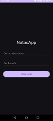
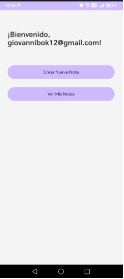
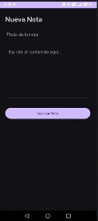
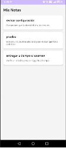

# NotasApp - Evaluación Parcial II

Aplicación móvil nativa desarrollada en Android (Kotlin) con arquitectura MVVM, conectada a un backend REST en C# .NET 8 con autenticación JWT y persistencia de datos en SQLite mediante Entity Framework Core.

## Enlaces de Entrega

- **Repositorio GitHub:** [NotasApp](https://github.com/giobok10/NotasApp)
- **Video demostrativo:** [YouTube](https://youtu.be/E6C2f8Ut9sA)

## Stack Tecnológico

- **Móvil:** Kotlin, Android SDK (API 34), MVVM, LiveData, Corrutinas, Retrofit 2, OkHttp 3, ConstraintLayout, LinearLayout, RecyclerView y CardView.
- **Backend:** C# .NET 8 Web API, Entity Framework Core 8, SQLite y JWT Bearer Authentication.
- **Entorno:** Windows 11, WSL 2 (Ubuntu), Android Studio y `adb reverse`.

## Capturas de Pantalla

| Login | Dashboard | Creación de Nota | Listado de Notas |
|:---:|:---:|:---:|:---:|
|  |  |  |  |

## Ejecución del Proyecto

### Backend

```bash
cd backend
dotnet run --urls "http://0.0.0.0:5297"
```

### Aplicación Android

Abrir el proyecto ubicado en `android` con Android Studio y ejecutar la aplicación en un dispositivo Android conectado mediante USB.

```bash
adb reverse tcp:5297 tcp:5297
```